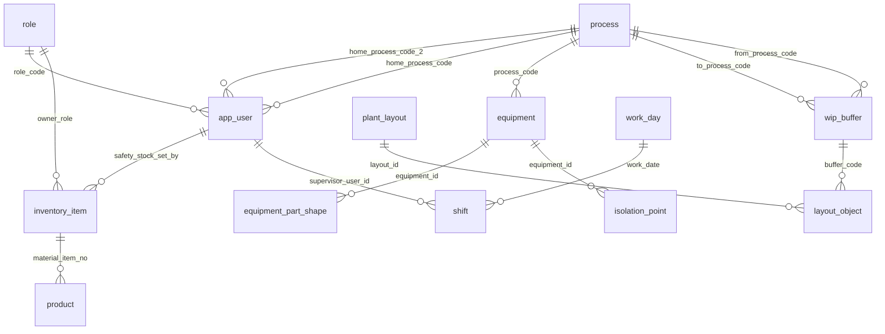
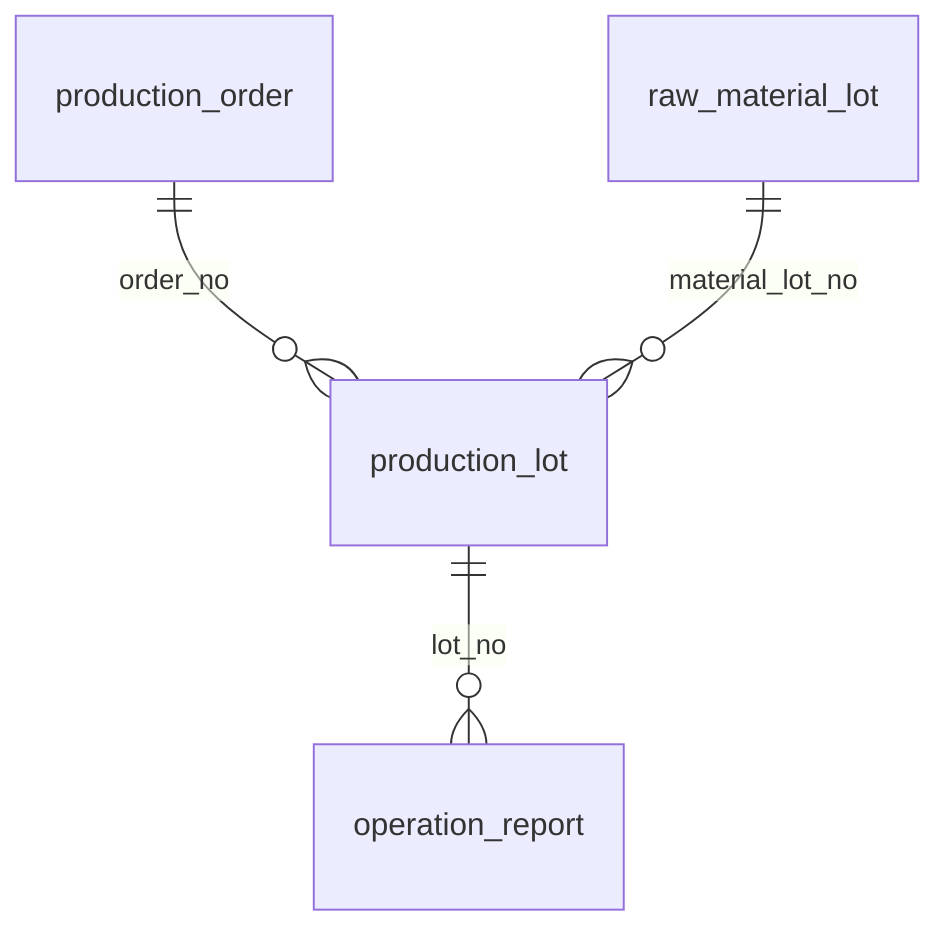
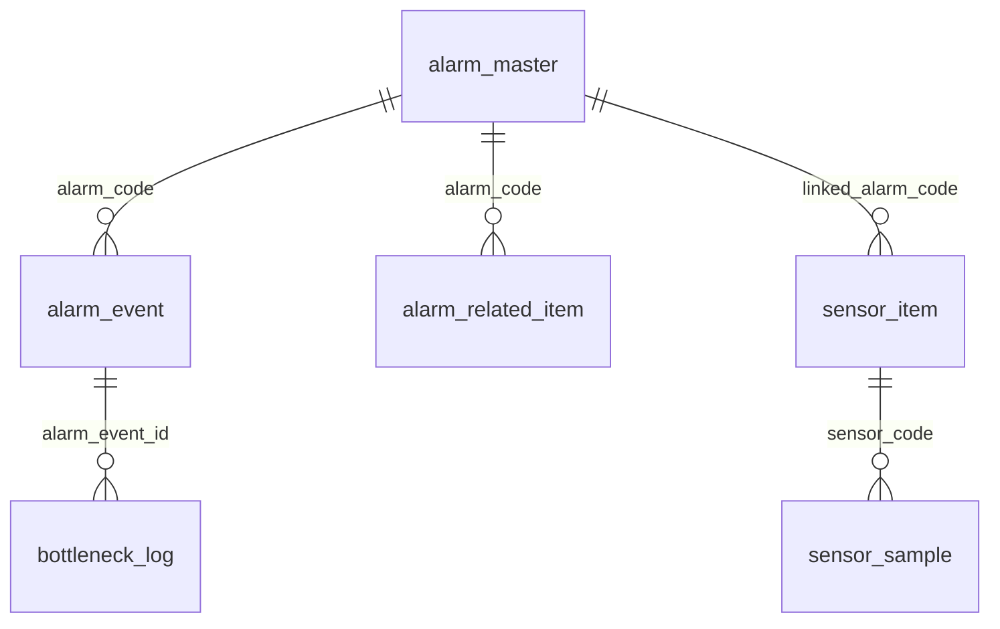
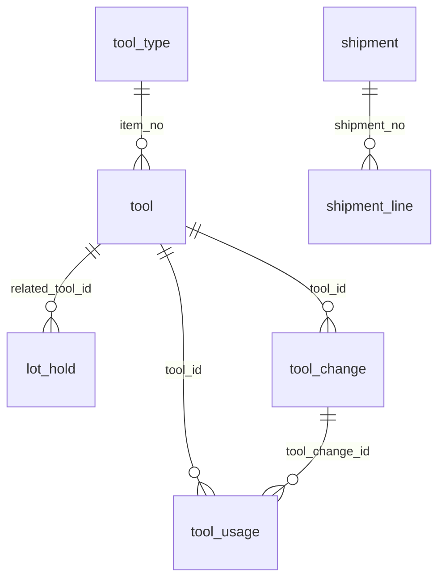
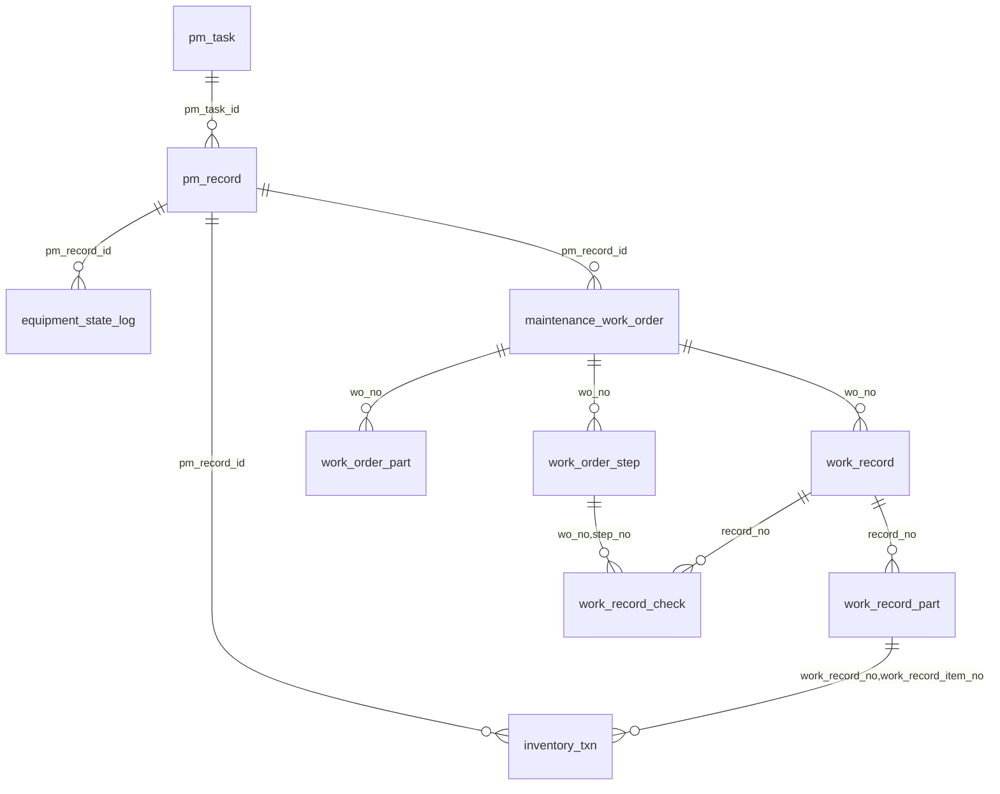
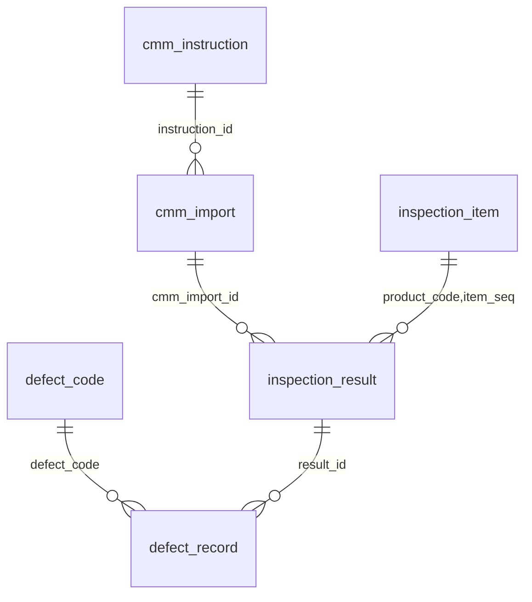
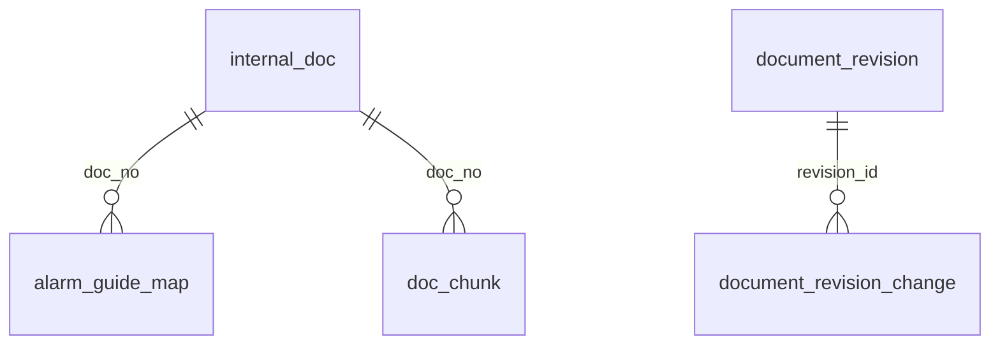
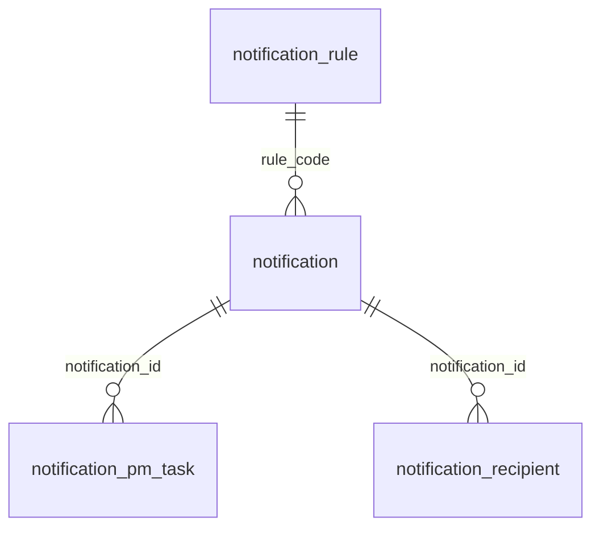

# 02. 물리 ERD (PostgreSQL 16)

> 논리 ERD 최종본(엔터티 58개, 속성 564개, 관계 125개, 코드 6장)을 PostgreSQL 테이블로 옮긴 결과와 그 규칙.
> 10장 표·그림은 `tools/gen_schema_doc.py`가 **실제 DB 카탈로그**에서 만든 것이다 (스키마를 바꾸면 다시 만든다).

## 1. 결과 요약

| 항목 | 수 | 확인 |
|---|---|---|
| 테이블 | 67 (논리 59 + 물리 추가 8) + 센서 파티션 2 | `tools/check_attributes.py` — 엔터티 59개 모두 테이블 있음 |
| 속성 | 564 → 칼럼 551 + 뷰 계산 12 + 나중 1(embedding) | 같은 도구 |
| 관계 | 논리 125 → 외래 키 122 + 다른 방법 3 (9장) | `tools/check_relations.py` — 125개 일치 |
| 물리 외래 키 | 154 (사용자·기록 참조 포함) | 10장 |
| 코드 | 코드 묶음 73개, CHECK 허용 값 = 6장 코드 | `tools/check_codes.py` — 73개 OK |
| 뷰 / 업무 함수 | 14 / 43 | 6장, `01_백엔드_설계서.md` 3장 |

## 2. 변환 규칙

| 논리 | 물리 | 예 |
|---|---|---|
| 이름 | 논리 ERD의 영어 속성 이름 그대로 (snake_case) | `equipment_state_log.reason_status` |
| 문자 / 코드 | `varchar(n)` — 코드는 가장 긴 코드 길이, 이름은 넉넉히 | `state_code varchar(7)` |
| 정수 / 소수 | `integer`·`smallint` / `numeric(p,s)` (수량 3자리, 시간 2자리) | `qty_change numeric(12,3)` |
| 시각 / 날짜 | `timestamptz` (한국 시간으로 보임) / `date` | 교대의 `work_date date` |
| 참·거짓 | `boolean NOT NULL DEFAULT` | `warn_marker` |
| 여러 값 | 역할 목록은 `text[]`, 칸 묶음은 `jsonb` [제안] | `processor_roles text[]`, `availability_pct jsonb` |
| 업무 키 | 업무 번호가 있으면 그 번호가 PK (`lot_no`, `wo_no`, `record_no`, `shipment_no`) | |
| 사건·기록 | `bigint GENERATED BY DEFAULT AS IDENTITY` (생성기가 번호를 넣을 수 있게 BY DEFAULT) | `alarm_event_id` |
| 코드 | `CHECK (x IN (...))` + `code_label`에 한국어 이름 | 6장 코드 73묶음 |
| 필수(○) | `NOT NULL` (예외는 9장) | |

## 3. 물리 추가 테이블 8개

| 테이블 | 왜 |
|---|---|
| `code_label` | 6장 코드의 한국어 이름을 화면·비서·보고서가 같은 곳에서 읽게 |
| `doc_number_seq` | 업무 번호(PO·MW·MR·MR-S·SHP·MAT) 월별 카운터 — 동시에 불러도 겹치지 않게 행 잠금 |
| `sim_clock` | 시연 시계 (NFR-DATA-10): 빠른 진행·건너뛰기·멈춤. 4장 |
| `dataset_info` | 가상 데이터 표시(R-59, NFR-DATA-08)와 생성기 manifest(seed·설정 해시·기간) |
| `sensor_hourly`, `wip_hourly` | 보관 L2(6.53): 1년 지난 1분 값을 1시간 집계로 줄여 2년 |
| `cmm_instruction` | 논리 ERD 11장 #20 "측정 지시를 엔터티로 둘지" → 둔다 [제안]. 결과 파일과 지시 대조(R-78), 결과 미수신의 시작 시각 |
| `access_log` | 접속 기록 1년 (6.53 ACCESS_LOG). 실제 시각 `now()` |
| `briefing_check` | 물리 추가: 브리핑 먼저 챙길 일 체크 (2026-10-20) — 사용자별·교대별·항목 글자별, 본인 것만, 개인 메모일 뿐 알림·알람 처리와 무관 | 4 | user_id, shift_id, item_key | app_user | 2 | 0 | 0 |

(2026-10-08에 만든 알람 ↔ 재고 품목 연결 `alarm_related_item`은 논리 ERD 5.C.8 엔터티가 되어 `schema/30_equipment_alarm.sql`에 있다 — R-89)

- 시연 기준점(SIM-03): 별도 스키마 `demo_snapshot` (`schema/96_demo_snapshot.sql`) — 운영 표 복사본 + `meta`(찍은 시각·시연 시계). 논리 ERD 밖, 운영에서는 쓰지 않음 (`01` 13a장)

## 4. 시간

- 업무 시각 칼럼은 모두 `timestamptz`. 값은 `app_now()`(시연 시계)로 정한다 — 함수·뷰에서 `now()`를 직접 쓰지 않는다. 예외: `access_log.at`, `app_user.last_login_at`, 시계 자체.
- DB 세션 시간대 `Asia/Seoul`(앱 연결 옵션·계정 설정). 월 번호(YYMM)·근무일은 한국 시간 기준으로 자른다.
- 야간 교대의 날짜는 `shift.work_date`(시작한 날). 보고서·KPI는 `shift_id`·`work_date`로 묶는다.

## 5. 여러 값 속성

- 작업지시서 계기(`trigger_kind`, 여러 값): 따로 저장하지 않는다. 계기 FK 세 칸(`alarm_event_id`·`trigger_notification_id`·`pm_record_id`) 중 채워진 칸이 곧 계기이고 `v_work_order.trigger_kind`로 보인다. 적어도 하나는 있어야 한다(`ck_wo_trigger`). 같은 알람과 2단계가 겹치면 작업지시서 1개 (R-71).
- 알림의 관련 기록(알람·설비·로트·품목·공구·작업지시서·버전·측정값·교대·재공·CMM 파일…): 각각 nullable FK 칼럼.
- 역할 목록(`processor_roles`, `recipient_roles`): `text[]`.
- 교대 보고서 설비별 가동률: `jsonb {"VF2-01": 81.2, "VF2-02": 77.0}` [제안].
- 문서 버전 본문: `content_snapshot jsonb` (비서 출력 JSON 칸과 같은 모양) [제안], 바뀐 칸은 `document_revision_change` 행.

## 6. 계산 속성 — 뷰 또는 저장

| 속성 | 방법 | 이유 |
|---|---|---|
| `inventory_item.on_hand_qty` | **저장** + `inventory_txn` INSERT 트리거만 바꿈, `CHECK >= 0` | 음수 재고를 그 순간 막기(R-11), 자주 읽음 |
| `equipment_state_log.duration_min` | 생성 칼럼 (끝 − 시작) | 한 행 안 계산 |
| `equipment_state_log.stop_loss_qty` | 저장 — 구간이 끝나거나 사유가 바뀔 때 트리거가 계산 (길이 ÷ 기준 사이클, 계획 정지 제외). 생성기가 넣은 값은 그대로 | 설계서 5.10 "계산해 저장" |
| `tool.cum_usage` | 저장 — `fn_add_tool_usage`가 누적 | 공구 사용 기록 B안 (9장) |
| 완료 수량·남은 완제품·출하 수량 (`v_production_lot`) | 뷰 | 실적·출하에서 매번 계산 |
| 공구 사용률·남은 부품 (`v_tool_life`), 다음 정비일 (`v_pm_task_due`) | 뷰 | |
| 가공 설비 (`v_inspection_result.machined_equipment_id`, [제안] P-11) | 뷰 | 로트의 OP-30 실적에서 |
| KPI·OEE (`v_shift_equipment_kpi`, `v_shift_line_oee`), MTTR·MTBF (`v_equipment_reliability_30d`), 보고 순위 (`v_report_items` → 묶은 줄 `v_report_lines`), 총 목표·예측 (`v_shift_target`, `v_shift_progress`) | 뷰 | DOC-07 정의를 SQL 한 곳에 |
| 작업지시서 계기·승인 대기 분 (`v_work_order`), 출하 합계·지연 (`v_shipment`) | 뷰 | |

## 7. 규칙을 지키는 방법

1. 한 행 안에서 되는 규칙 → `CHECK` (예: R-19 생산 = 양품 + 재작업 + 불량, 확정이면 확정자·시각 필수).
2. 여러 표를 봐야 하는 규칙 → 트리거 (`db/functions/20_integrity.sql`) — 확정자 역할, 상태 순서, 재공 한도, 원자재 사용 가능, LOTO 9단계.
3. **상태가 바뀌는 순간**의 규칙은 UPDATE 때만 확인한다. 생성기가 이미 확정된 과거 기록을 INSERT로 넣을 때는 하위 행이 아직 없기 때문 → 적재 뒤 `db/checks/validate_loaded_data.sql` 18개 점검.
4. 겹치면 안 되는 구간 → `EXCLUDE USING gist` (R-04 설비 상태 구간).
5. 추가만 하는 표(재고 거래·문서 버전·바뀐 칸·접속 기록) → `trg_append_only` (고치기 막음, 지우기는 보관 작업 `app.allow_purge = on`일 때만). 재고를 바로잡을 때는 조정(ADJUST) 거래를 새로 넣는다.
6. 확정 문서 → `trg_doc_lock(문서 종류, 키, 잠긴 상태, 바꿔도 되는 칸)` + 버전 짝 확인 (R-35).
7. 여러 표를 함께 바꾸는 일 → 업무 함수 하나 (`fn_*`) — API·시뮬레이터·시험이 같은 함수를 부른다.

## 8. 대용량·색인·순환

- 센서 `sensor_sample`은 `LIST (interval_type)` 파티션 `1S`·`1M` + 시각 BRIN 색인. 30일 넘게 운영하면 월별 하위 파티션으로 나눈다 [선택 필요: 운영 기간].
- 시계열(센서 파티션, `wip_log`, `access_log`)은 BRIN, 조회 조건 칼럼은 B-tree, "열린 것만" 조건은 부분 색인 (예: 문제 있는 CMM 파일 `WHERE status <> 'SUCCESS'`). 색인 47개.
- 서로를 가리키는 외래 키(작업지시서 ↔ 알림, 간이 기록 → 원인 점검 알림)는 `DEFERRABLE INITIALLY DEFERRED` (`95_deferred_fks.sql`) — 한 트랜잭션 안에서 순서 없이 넣고 커밋 때 확인.

## 9. 논리와 다르게 한 곳

| # | 논리 | 물리 | 이유 |
|---|---|---|---|
| 1 | 관계 #125 측정값 → 가공 설비 | FK 없음, 뷰 `v_inspection_result`에서 계산 | [제안] P-11 "로트의 OP-30 실적에서 정함" — 저장하면 두 곳이 어긋날 수 있음 |
| 2 | 관계 #93·#124 문서 → 버전 | `document_revision(doc_type, doc_key)` 다형 참조 | 문서 7종의 키 형식이 서로 다름. `fn_save_revision`·잠금 트리거가 확인 |
| 3 | `equipment_part_shape.offset_z_mm` 필수 | 비움 허용 | R1 표의 CMM-01 터치스크린에 값이 없음 |
| 4 | `inspection_result.position` "빈칸 = 표준" | `'STD'`로 저장, NOT NULL [제안] | 고유 키(로트·순번·항목·위치·재측정)에 NULL이 들어가지 않게 |
| 5 | 공구 사용 기록 단위 | 공정 실적 1건 × 공구, 교체가 끼면 구간(seg)을 나눔 [제안: B안] | 실적 단위로 누적·교체 전후 구분 (`tool_usage`) |
| 6 | `lot_hold` 해제 수량 | `released_pass_qty` 칼럼 추가 | R-69 ② "해제 시각에 고른 합격 수량만 완제품으로" |
| 7 | `notification_rule` | `process_mode`·`processor_roles`·`recipient_roles`·`report_rank`·`rank_group` 추가 [제안] | 6.36 처리 방식·6.43 보고 순위를 서버가 표로 읽게 |
| 8 | 사진 | 저장하지 않음 [제안: 범위 밖] | 팀 결정 대기 항목을 범위 밖으로 두고, 필요하면 `file_ref` 칼럼 방식으로 추가 |

## 10. 테이블과 관계 (실제 DB에서 생성)

<!-- BEGIN:schema -->
<!-- tools/gen_schema_doc.py 가 실제 DB에서 만든 부분: 테이블 72개 (파티션 제외), 외래 키 166개, 뷰 18개, 업무 함수 79개 -->

### 기준 정보 (`db/schema/10_master.sql`, 13개)

| 테이블 | 설명 | 칼럼 | PK | 바깥 참조 (FK) | CHECK | UNIQUE·EXCLUDE | 트리거 |
|---|---|---|---|---|---|---|---|
| `app_user` | 사용자 (5.H.1). 퇴사해도 행을 지우지 않고 is_active=false (6.53 USER) | 10 | user_id | — | 3 | 0 | 0 |
| `equipment` | 설비 6대 (5.A.2). 외형·배치 좌표는 mm, 원점·축은 plant_layout (R-83) | 17 | equipment_id | — | 10 | 1 | 0 |
| `equipment_part_shape` |  | 12 | equipment_id, shape_seq | — | 7 | 0 | 0 |
| `inventory_item` | 재고 품목 13개: 공구 5, 소모품 6, 원자재 1, 완제품 1 (5.E.5, 6.27) | 11 | item_no | — | 8 | 0 | 1 |
| `isolation_point` | 설비별 에너지 차단 지점 (5.A.3, DOC-05 §3) | 7 | isolation_point_id | — | 3 | 1 | 0 |
| `layout_object` |  | 11 | object_id | — | 6 | 1 | 0 |
| `plant_layout` | 공장 배치 (5.A.8) · 배치 물체 (5.A.9) · 설비 부품 도형 (5.A.10) | 10 | layout_id | — | 6 | 0 | 0 |
| `process` | 라인 공정 5개 OP-10~OP-50 (5.A.1) | 5 | process_code | — | 2 | 1 | 0 |
| `product` | 제품 (5.A.4) | 6 | product_code | — | 1 | 0 | 0 |
| `role` | 역할 4종 (6.37) | 2 | role_code | — | 1 | 0 | 0 |
| `shift` | 교대 (5.A.6). 야간 교대는 다음 날 05:00에 끝나도 work_date는 시작한 날 — 날짜 계산은 DATE(시각)이 아니라 이 칸으로 | 9 | shift_id | — | 7 | 1 | 1 |
| `wip_buffer` | 재공 위치 (5.A.7) | 7 | buffer_code | — | 5 | 2 | 0 |
| `work_day` | 근무일 (5.A.5) · 교대 (5.A.6) | 3 | work_date | — | 2 | 0 | 0 |

### 생산 (`db/schema/20_production.sql`, 5개)

| 테이블 | 설명 | 칼럼 | PK | 바깥 참조 (FK) | CHECK | UNIQUE·EXCLUDE | 트리거 |
|---|---|---|---|---|---|---|---|
| `operation_report` | 공정 실적 (5.B.4) | 12 | op_report_id | app_user, equipment, process, shift | 6 | 1 | 0 |
| `production_lot` | 생산 로트 (5.B.3) | 9 | lot_no | shift | 7 | 1 | 2 |
| `production_order` | 생산 작업지시 (5.B.2) | 8 | order_no | product | 6 | 0 | 0 |
| `raw_material_lot` | 원자재 로트 (5.B.1). AVAILABLE일 때만 생산 로트에 쓸 수 있다 (R-06a, 트리거) | 7 | material_lot_no | inventory_item | 3 | 0 | 1 |
| `wip_log` | 재공 기록 (5.B.5) — L2 시계열 (1년 → 1시간 집계 wip_hourly) | 5 | buffer_code, logged_at | wip_buffer | 4 | 0 | 3 |

### 설비·알람 (`db/schema/30_equipment_alarm.sql`, 7개)

| 테이블 | 설명 | 칼럼 | PK | 바깥 참조 (FK) | CHECK | UNIQUE·EXCLUDE | 트리거 |
|---|---|---|---|---|---|---|---|
| `alarm_event` | 알람 이벤트 (5.C.3) — L3 (2년) | 10 | alarm_event_id | alarm_event, equipment, production_lot | 5 | 0 | 2 |
| `alarm_master` | 알람 코드집 (5.C.1) — 내용(원문 이름·설명)은 생성기 기준 정보 CSV로 넣는다. | 15 | alarm_code | process | 3 | 0 | 0 |
| `alarm_related_item` | 알람 ↔ 관련 재고 품목 (같은 원인 묶기). 예방 정비 항목은 pm_task.default_item_no로 이어진다 | 4 | alarm_code, item_no | inventory_item | 0 | 0 | 0 |
| `bottleneck_log` | 병목 기록 (5.B.6) — 다음 행까지가 한 구간. interval_end_at·planned_qty는 v_bottleneck_interval | 9 | bottleneck_log_id | process | 2 | 1 | 3 |
| `downtime_reason` | 정지 사유 코드 (5.C.5, 6.5) | 7 | reason_code | — | 5 | 0 | 0 |
| `sensor_item` | 센서 항목 (5.C.6) — 알람 기준값 칸은 두지 않는다 | 7 | sensor_code | — | 1 | 0 | 0 |
| `sensor_sample` | OP-30 센서 값 (5.C.7). 1S = 알람·병목 앞뒤 30분, 1M = 평소 1분 평균. 30일 넘게 운영하면 월별 하위 파티션으로 나눈… · 파티션(1S·1M) | 5 | equipment_id, sensor_code, sampled_at, interval_type | equipment | 1 | 0 | 0 |

### 공구·재고·출하 (`db/schema/40_tool_shipment.sql`, 7개)

| 테이블 | 설명 | 칼럼 | PK | 바깥 참조 (FK) | CHECK | UNIQUE·EXCLUDE | 트리거 |
|---|---|---|---|---|---|---|---|
| `lot_hold` | 로트 보류 기록 (5.B.7) — 사람 결정(누가·언제·왜). 역할 확인은 트리거 | 19 | hold_id | alarm_event, app_user, production_lot | 11 | 0 | 1 |
| `shipment` | 출하 (5.E.7) · 출하 내역 (5.E.8) | 10 | shipment_no | app_user | 5 | 0 | 2 |
| `shipment_line` |  | 4 | shipment_no, lot_no | production_lot | 1 | 0 | 0 |
| `tool` | 공구 (5.E.2) — VF-2에 꽂힌 공구 자리. usage_rate_pct는 v_tool_life | 8 | tool_id | equipment | 4 | 1 | 1 |
| `tool_change` | 공구 교체 기록 (5.E.4) | 7 | tool_change_id | alarm_event, app_user | 2 | 1 | 1 |
| `tool_type` | 공구 종류 (5.E.1) — 공구 품목과 1:1 | 6 | item_no | inventory_item | 4 | 0 | 0 |
| `tool_usage` | 공구 사용 기록 (5.E.3) — [제안] 공정 실적 + 교체로 구간을 나눔 (B안) | 8 | tool_id, op_report_id, seg | operation_report | 5 | 0 | 0 |

### 정비 (`db/schema/50_maintenance.sql`, 10개)

| 테이블 | 설명 | 칼럼 | PK | 바깥 참조 (FK) | CHECK | UNIQUE·EXCLUDE | 트리거 |
|---|---|---|---|---|---|---|---|
| `equipment_state_log` | 설비 상태 기록 (5.C.4) — 구간. L3 (2년) | 17 | state_log_id | alarm_event, app_user, downtime_reason, equipment | 9 | 2 | 3 |
| `inventory_txn` | 입출고 거래 (5.E.6) — 수불대장. 추가만 한다 (고치기·지우기 금지 트리거) | 17 | txn_id | app_user, inventory_item, production_lot, raw_material_lot, shipment_line, tool_change | 7 | 0 | 4 |
| `maintenance_work_order` | 정비 작업지시서 (5.D.1) — OP-30만 (트리거) | 20 | wo_no | alarm_event, app_user, equipment, notification (지연), production_lot | 7 | 3 | 4 |
| `pm_record` | 예방 정비 실시 기록 (5.D.8) — 수정 이력 대상 (PM_RECORD) | 13 | pm_record_id | app_user | 4 | 0 | 3 |
| `pm_task` | 예방 정비 항목 (5.D.7) — next_due_date는 v_pm_task_due | 12 | pm_task_id | equipment, inventory_item | 5 | 0 | 0 |
| `work_order_part` |  | 3 | wo_no, item_no | inventory_item | 1 | 0 | 0 |
| `work_order_step` |  | 4 | wo_no, step_no | — | 1 | 0 | 0 |
| `work_record` | 작업기록서 (5.D.4) — FULL 작업기록서 / SIMPLE 간이 작업기록 | 20 | record_no | alarm_event, app_user, equipment, notification (지연), production_lot | 12 | 3 | 4 |
| `work_record_check` |  | 9 | record_no, check_seq | app_user | 6 | 0 | 0 |
| `work_record_part` |  | 4 | record_no, item_no | inventory_item | 2 | 0 | 0 |

### 품질 (`db/schema/60_quality.sql`, 7개)

| 테이블 | 설명 | 칼럼 | PK | 바깥 참조 (FK) | CHECK | UNIQUE·EXCLUDE | 트리거 |
|---|---|---|---|---|---|---|---|
| `cmm_import` | 측정 결과 파일 가져오기 (5.F.6) | 20 | cmm_import_id | equipment, production_lot | 6 | 1 | 0 |
| `cmm_instruction` | 측정 지시 [제안: 물리 추가] — 논리 ERD 11장 #20 "측정 지시 파일과 측정 시작 기록을 엔터티로 둘지" | 9 | instruction_id | app_user, production_lot | 6 | 0 | 0 |
| `defect_code` | 불량 코드 (5.F.2) — grade는 기본 등급, 예외는 grade_rule 글로 (예: DIM-01 "1번은 치명") | 7 | defect_code | — | 2 | 0 | 0 |
| `defect_record` | 불량 기록 (5.F.5) | 9 | defect_record_id | app_user, process, production_lot | 2 | 1 | 1 |
| `inspection_item` | 검사 항목 (5.F.1) | 13 | product_code, item_seq | product | 6 | 0 | 0 |
| `inspection_plan` | 검사 방식 (5.F.3) — 로트 1 : 1. planned_measure_qty는 v_production_lot | 8 | lot_no | lot_hold, production_lot | 7 | 0 | 0 |
| `inspection_result` | 검사 결과 (5.F.4) — 측정한 부품만 (R-26). 측정값은 지우지 않는다 (R-75) | 26 | result_id | app_user, equipment, production_lot | 14 | 1 | 2 |

### 문서·보고서 (`db/schema/70_documents.sql`, 9개)

| 테이블 | 설명 | 칼럼 | PK | 바깥 참조 (FK) | CHECK | UNIQUE·EXCLUDE | 트리거 |
|---|---|---|---|---|---|---|---|
| `alarm_check_step` | 알람 점검 순서 [물리 추가, 2026-10-20 — 작업지시서 초안 자동 생성 FR-MNT-03-01·05, 1018 §23 "점검 순서를 D… | 4 | alarm_code, seq | — | 2 | 0 | 0 |
| `alarm_guide_map` | 알람-고장 대응 연결 (5.C.2) — 원문 출처 칸 없음 (R-85) | 4 | alarm_code, seq | alarm_master | 1 | 0 | 0 |
| `chat_log` | 채팅 기록 (5.G.7). 본인 것만 보고 30일 보관 (6.53 #18, R-87). 밖으로 보내지 않음 | 9 | chat_id | app_user, chat_log | 4 | 0 | 0 |
| `daily_report` | 일일 보고서 (5.G.2) — 생산일 다음 날 06:00 초안 (R-72). 확정 = MGR (트리거) | 13 | work_date | app_user, work_day | 8 | 0 | 3 |
| `doc_chunk` | 사내 문서 조각 (5.G.6) — 검색용. 임베딩 칸은 모델을 고른 뒤 db/later/ 로 더한다 | 6 | chunk_id | — | 0 | 0 | 0 |
| `document_revision` | 문서 버전 (5.G.3) · 버전 변경 칸 (5.G.4) — 추가만 한다 (트리거가 고치기·지우기를 막음) | 11 | revision_id | app_user | 6 | 1 | 2 |
| `document_revision_change` |  | 4 | revision_id, field_name | — | 1 | 0 | 1 |
| `internal_doc` | 사내 문서 (5.G.5) — DOC-01~07 + 용어집 | 10 | doc_no | app_user | 6 | 0 | 1 |
| `shift_report` | 교대 보고서 (5.G.1) — 교대 1 : 보고서 0..1. 확정자 = 그 교대 반장 (R-36, 트리거) | 11 | shift_id | app_user, shift | 7 | 0 | 3 |

### 알림·사용자·권한 (`db/schema/80_notification_auth.sql`, 7개)

| 테이블 | 설명 | 칼럼 | PK | 바깥 참조 (FK) | CHECK | UNIQUE·EXCLUDE | 트리거 |
|---|---|---|---|---|---|---|---|
| `access_log` | 물리 추가: 접속 기록 1년 보관 (6.53 ACCESS_LOG, 개인정보 안전성 확보조치 기준 제8조). 실제 시각(now) 기준 | 9 | access_log_id | app_user | 1 | 0 | 1 |
| `briefing_check` | 물리 추가 (2026-10-20): 브리핑 먼저 챙길 일 체크 — 본인 것만, 시각은 시연 시계(app_now) | 4 | user_id, shift_id, item_key | app_user | 2 | 0 | 0 |
| `notification` | 알림 (5.H.5) — L3 (2년). report_rank는 계산 (시간이 지나면 바뀌므로 저장하지 않음) | 30 | notification_id | alarm_event, app_user, bottleneck_log, cmm_import, document_revision, equipment, inspection_result, inventory_item, maintenance_work_order (지연), notification, pm_task, production_lot, shift, tool, wip_buffer | 12 | 0 | 1 |
| `notification_pm_task` | 알림 ↔ 예방 정비 항목 [물리 추가, 2026-10-20 정비 탭 확인 요청 5] — 여러 항목을 1건으로 묶는 알림의 관련 항목 | 2 | notification_id, pm_task_id | pm_task | 0 | 0 | 0 |
| `notification_recipient` |  | 4 | notification_id, user_id | app_user | 0 | 0 | 0 |
| `notification_rule` | 알림 규칙 (5.H.4) — 규칙이 정하고 비서는 문장만 (R-38) | 13 | rule_code | app_user | 6 | 0 | 1 |
| `role_permission` | 역할별 권한 (5.H.3) — 기획서 13.1·13.2 표를 데이터로. 서버가 이 표로 막는다 (NFR-SEC-05) | 4 | role_code, target, action | role | 2 | 0 | 0 |

### 물리 추가 (논리 ERD 밖) (`db/schema/90_physical_extras.sql`, 7개)

| 테이블 | 설명 | 칼럼 | PK | 바깥 참조 (FK) | CHECK | UNIQUE·EXCLUDE | 트리거 |
|---|---|---|---|---|---|---|---|
| `code_label` | 코드 한국어 이름 (6장 코드 목록). 화면·비서가 같은 이름을 쓰도록 한 곳에 둔다 | 5 | code_group, code | — | 0 | 0 | 0 |
| `dataset_info` | 데이터 묶음 정보 (R-59, NFR-DATA-08 가상 표시를 묶음 단위로) + 생성기 manifest | 9 | id | — | 1 | 0 | 0 |
| `doc_number_seq` | 업무 번호 카운터 (PO-, SHP-, MW-, MR-, MR-S-, MAT-) — 월마다 1부터. fn_next_doc_no()가 쓴다 | 3 | prefix, yymm | — | 2 | 0 | 0 |
| `qr_scan` | 물리 추가 [제안]: QR 찍은 기록 (재고·로트 QR 가정, 2026-10-13). 출하 전 로트 확인·측정 시작 로트 확인의 근거 | 12 | scan_id | app_user, cmm_instruction, inventory_txn, shipment | 7 | 0 | 1 |
| `sensor_hourly` | L2 집계 (6.53): 1년 지난 센서 1분 값·재공 값을 1시간 집계로 줄여 2년 보관 | 7 | equipment_id, sensor_code, hour_at | equipment, sensor_item | 2 | 0 | 0 |
| `sim_clock` | 시연 시계 (NFR-DATA-10): 평소 1초 = 1분 같은 빠른 진행, 다음 날 06:00으로 건너뛰기. | 7 | id | — | 3 | 0 | 0 |
| `wip_hourly` |  | 4 | buffer_code, hour_at | wip_buffer | 1 | 0 | 0 |

### 뷰 (계산 속성·화면용 읽기)

`v_bottleneck_interval`, `v_equipment_now`, `v_equipment_reliability_30d`, `v_inspection_result`, `v_inventory_status`, `v_lock_status`, `v_lot_trace`, `v_pm_task_due`, `v_production_lot`, `v_report_items`, `v_report_lines`, `v_shift_equipment_kpi`, `v_shift_line_oee`, `v_shift_progress`, `v_shift_target`, `v_shipment`, `v_tool_life`, `v_work_order`

### 업무 함수 (여러 표를 함께 바꾸는 일 — db/functions/)

`app_now`, `fn_add_tool_usage`, `fn_add_work_minutes`, `fn_auto_process`, `fn_auto_work_order_draft`, `fn_bottleneck_action_line`, `fn_bottleneck_cause_ko`, `fn_check_cpk`, `fn_check_measurement`, `fn_check_repeat_alarm`, `fn_check_stock`, `fn_close_pm_due_soon`, `fn_confirm_shipment`, `fn_confirm_work_record`, `fn_create_daily_report_draft`, `fn_create_inspection_plan`, `fn_create_order`, `fn_create_shift_report_draft`, `fn_create_work_order_draft`, `fn_daily_issues_text`, `fn_demo_reset`, `fn_demo_snapshot`, `fn_demo_tables`, `fn_doc_status`, `fn_ensure_work_day`, `fn_equipment_process`, `fn_failure_loss_qty`, `fn_flood_state`, `fn_import_cmm`, `fn_ingest_alarm`, `fn_interval_losses`, `fn_issue_cmm_instruction`, `fn_item_cpk`, `fn_lot_completed_qty`, `fn_lot_expected_complete`, `fn_lot_hold`, `fn_lot_judge`, `fn_lot_pass`, `fn_lot_release`, `fn_lot_scrap_approve`, `fn_lot_scrap_propose`, `fn_lot_to_inspection`, `fn_next_doc_no`, `fn_planned_parts`, `fn_pm_end`, `fn_pm_start`, `fn_process_notification`, `fn_purge_chat_log`, `fn_raise_lot_due_risk`, `fn_raise_notification`, `fn_raise_pm_due_soon`, `fn_raise_pm_record_check`, `fn_record_cmm_failure`, `fn_refill_daily_report`, `fn_refresh_carry_over`, `fn_report_item_line`, `fn_report_items_text`, `fn_report_production`, `fn_require_role`, `fn_resume_normal`, `fn_resume_sampling`, `fn_retention_report`, `fn_run_time_rules`, `fn_save_revision`, `fn_seed_alarm_related_items`, `fn_shift_actual_qty`, `fn_shift_break_start`, `fn_ship_qr_unchecked`, `fn_sim_set`, `fn_simple_record_needs_loto`, `fn_speed_loss_qty`, `fn_split_memo`, `fn_start_lot`, `fn_state_change`, `fn_sync_after_load`, `fn_sync_doc_numbers`, `fn_tool_change`, `fn_user_role`, `fn_work_minutes`
<!-- END:schema -->

